# Architecture

Reachy Gaze is a Reachy Mini app that points the robot's head at people and
pets. It is split across two machines: the **robot** runs the app (control
loop, vision thread and control panel), and a **GPU machine** runs object
detection. The robot sends downscaled JPEGs over the network and gets
bounding boxes back.

This document covers how the pieces fit together. See the
[README](README.md) for setup and the behaviour as a user sees it.

## Repository Layout

```
reachy_gaze/
├── main.py          # the app: ReachyGaze, shared State, control loop, vision thread, panel API
├── cycle.py         # look-around state machine (Phase, Cycle), random poses, Stillness
├── tracking.py      # TargetSelector, CenterFilter, PoseSmoother, coordinate helpers
├── detector.py      # Detector protocol, Triton / built-in / VLM clients, BACKENDS registry
├── server/
│   ├── app.py       # built-in FastAPI + YOLO detection server (reachy-gaze-server)
│   └── traffic.py   # per-client request accounting for the server's logs
└── static/          # control panel served by the app: index.html, main.js, style.css
tests/               # pytest suites per module, plus test_panel.mjs for main.js
index.html, style.css  # Hugging Face Space landing page (not the control panel)
.github/workflows/   # lint.yml (black, isort) and test.yml (pytest + node panel test)
```

## System Context

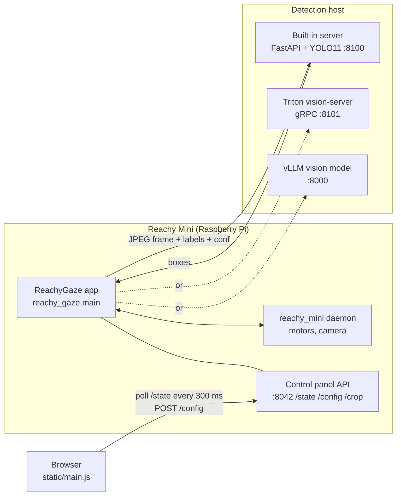

Only one backend is active at a time. It is chosen in the panel, or with
`REACHY_GAZE_BACKEND` and `REACHY_GAZE_SERVER_URL`.

## Module Dependencies

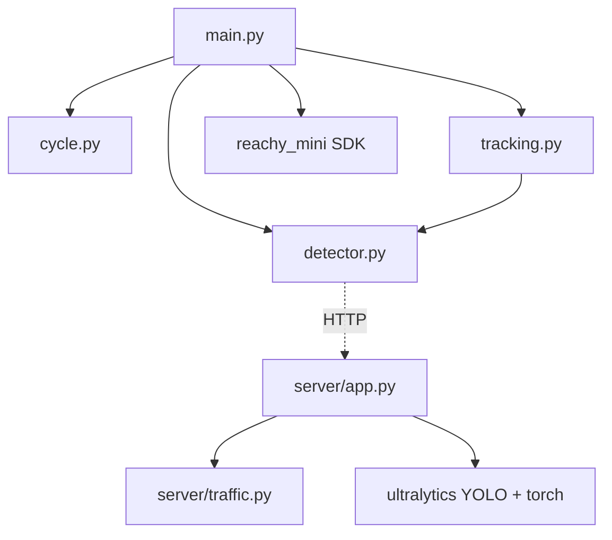

`cycle.py`, `tracking.py` and `detector.py` don't depend on the robot SDK,
so they can be tested in isolation. `server/` is installed only with the
`server` extra and never runs on the robot.

## Classes

### App and Shared State

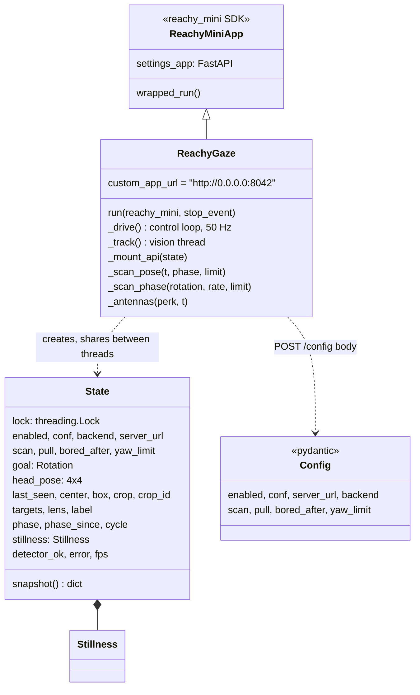

`State` is the only thing shared between the two threads and the HTTP
handlers. Every read and write happens under `State.lock`, and `snapshot()`
reads everything the panel shows in one consistent pass.

### Look-Around Cycle

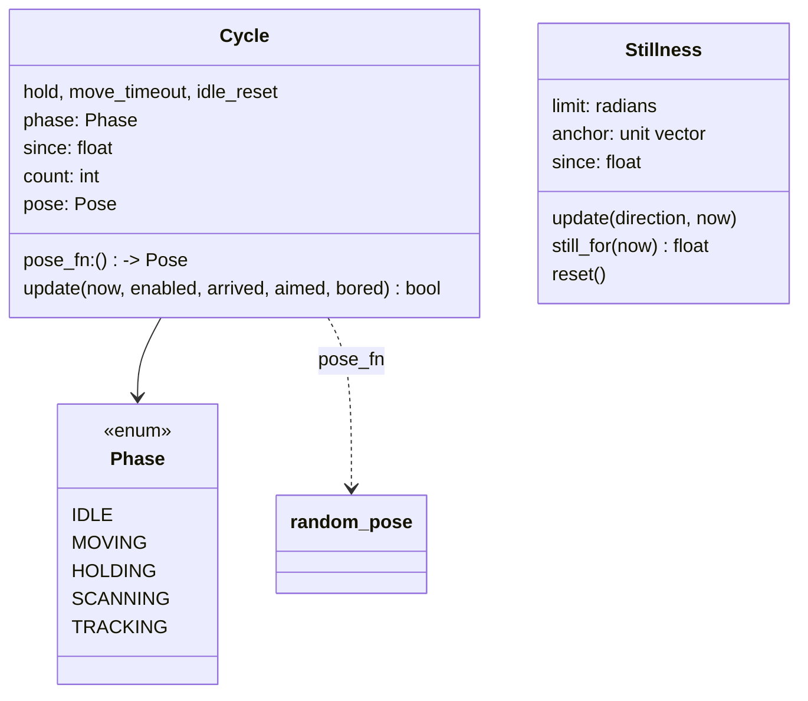

`Cycle` takes the current time as an argument rather than reading the clock,
so tests can step it through a whole cycle without waiting.

### Tracking and Smoothing

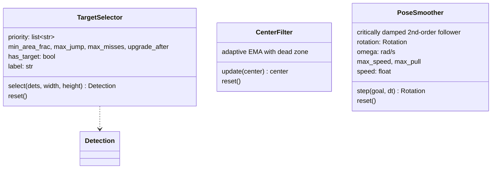

### Detectors

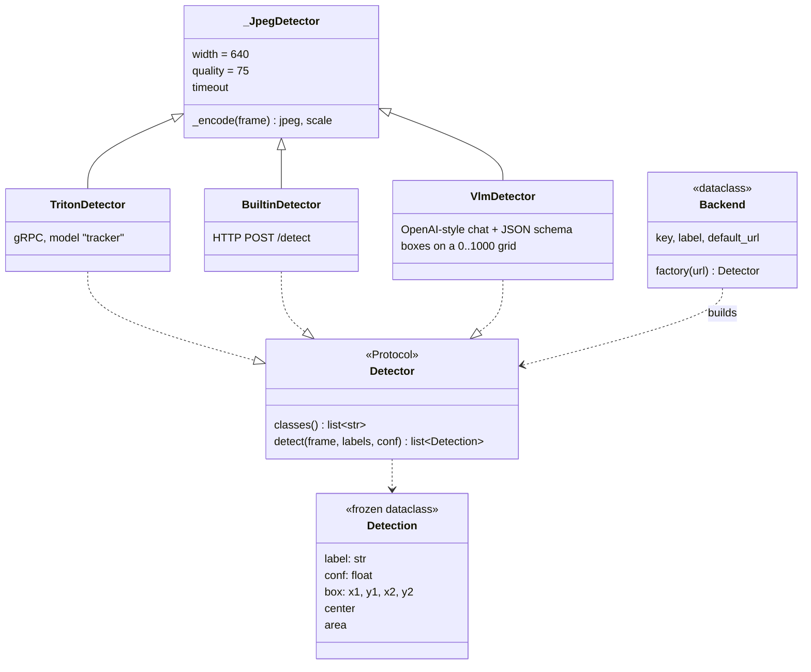

`BACKENDS` maps `"triton"`, `"builtin"` and `"vlm"` to a `Backend`, and
`make_detector(backend, url)` builds the client. To add a backend, write a
`Detector` and add one line to `BACKENDS`; the panel picks it up from
`/state`. A client raises `DetectorUnavailable` when its server is down or
answers with garbage. That is the only exception the vision thread catches.

## Runtime: Threads and Data Flow

`ReachyGaze.run` mounts the panel API, checks that the camera is calibrated,
turns on automatic body yaw, then starts two loops.

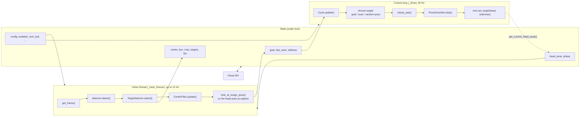

The two rates are deliberate. Detection is slow and comes in jumps, so the
vision thread only moves the **goal**. The control loop then moves the head
toward that goal smoothly at 50 Hz. `PoseSmoother` carries angular velocity
as state, so the commanded velocity stays continuous even when the goal jumps.

### One Detection, End to End

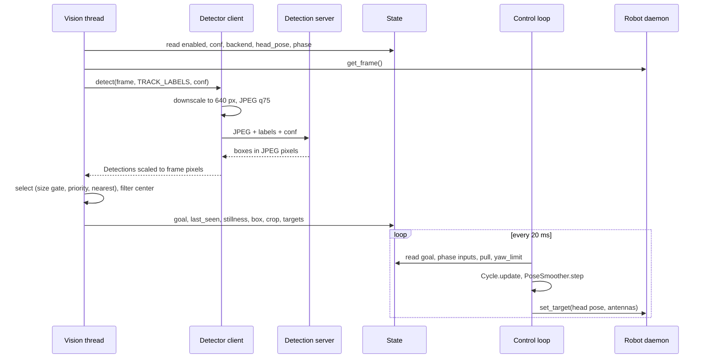

If the detector raises `DetectorUnavailable`, the vision thread marks
`detector_ok = False`, clears the targets and waits `RETRY_AFTER` (2 s)
before trying again. Changing the backend or URL in the panel rebuilds the
client and resets the selector and filter. It also calls `classes()` to warn
if the model can't detect one of `TRACK_LABELS`.

## The Look-Around Cycle

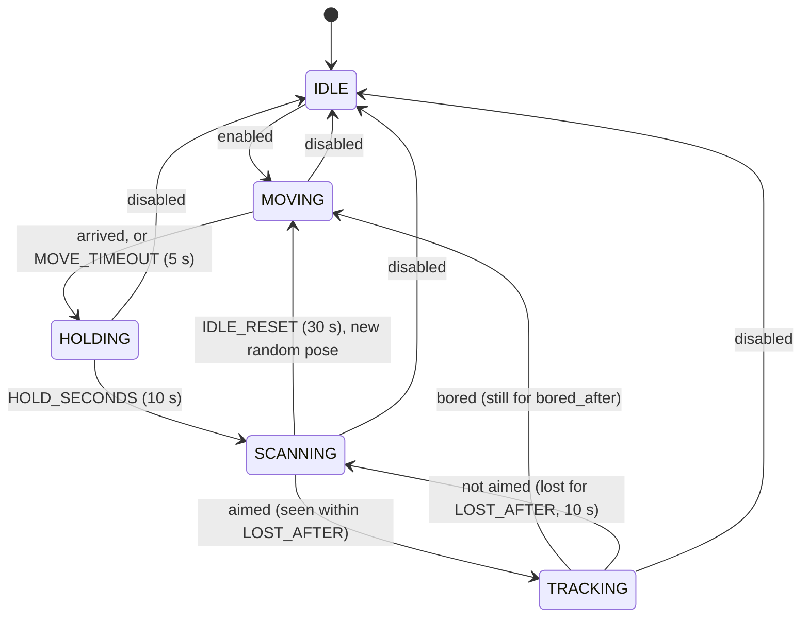

Each entry into `MOVING` draws a new random pose from `random_pose`, redrawn
until the head's kinematics can reach it, and increments `cycle`. On entering
a phase, `_enter_phase` publishes it to `State`. Outside `SCANNING` and
`TRACKING` it also clears the goal and the box, so a new cycle doesn't lock
straight back onto the target it just got bored of.

What the control loop aims at in each phase:

| Phase      | Head target                                                           |
| ---------- | --------------------------------------------------------------------- |
| `idle`     | Neutral orientation at `REST_POSITION`                                |
| `moving`   | The cycle's random pose                                               |
| `holding`  | The cycle's random pose                                               |
| `scanning` | A yaw sine sweep starting from the current yaw and direction          |
| `tracking` | `State.goal`, the world-frame direction of the target                 |

Every target is passed through `clamp_yaw` with the panel's Travel limit.
The antennas wag while searching and perk up while tracking, eased with
`BLEND_TAU`.

### Boredom

`Stillness` keeps the target's world-frame direction as an anchor. If the
target moves more than `STILL_DEGREES` (8°) from it, the anchor and clock
reset. A target that keeps moving is followed indefinitely. One that stays
put for `bored_after` seconds ends the cycle.

## Target Selection

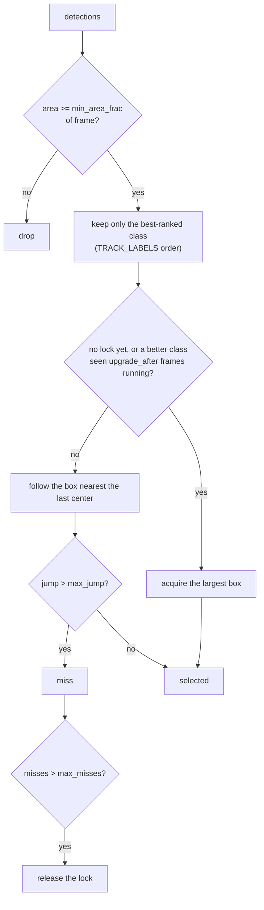

`TRACK_LABELS = ["cat", "dog", "bird", "person"]` sets both what to look for
and the preference order. A cat will take the head off a person, but only
after being seen for several frames in a row. That keeps a detection
flickering at the confidence threshold from bouncing the head between the
two. The size gate (`MIN_AREA_FRAC`, 1% of the frame) runs first, so a tiny
false positive of a preferred class can't hide a real one.

## Coordinate Conventions

| Quantity                  | Frame / units                                                       |
| ------------------------- | ------------------------------------------------------------------- |
| `Detection.box`           | Full-resolution camera pixels, `(x1, y1, x2, y2)`                   |
| Server reply              | Pixels of the JPEG sent, rescaled by `_encode`'s factor             |
| VLM reply                 | A 0–1000 grid, mapped to frame pixels                               |
| `norm_center`             | Box center in `[-1, 1]` on both axes                                |
| `State.box`               | Fractions of the frame, for the panel to draw                       |
| `State.goal`, head pose   | World frame: +X forward, +Y left, +Z up; body yaw included          |
| Head position             | Metres; raised by `HEAD_LIFT` so the head clears the body           |

The goal is computed with `look_at_image_pose` against the head pose
captured with the frame, not the current one. A detection that arrives late
still points where the target was.

## Control Panel

The app mounts three endpoints on the SDK's `settings_app` at `:8042`:

| Endpoint       | Purpose                                                                |
| -------------- | ---------------------------------------------------------------------- |
| `GET /state`   | `State.snapshot()`: settings, lock, phase, aim, boxes, lens, fps       |
| `GET /crop`    | JPEG of the current target box, or 404                                 |
| `POST /config` | Partial `Config` update; returns a fresh snapshot                      |

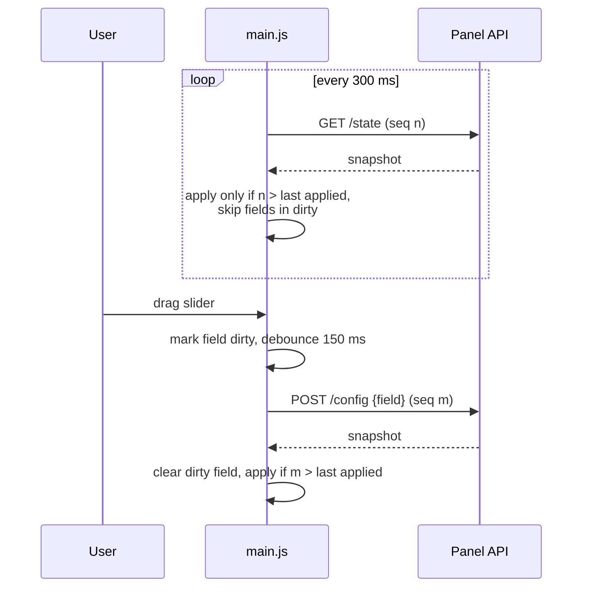

Responses can arrive out of order, so `main.js` numbers every request and
never lets an older response overwrite a newer one. Fields the user has
edited but the app hasn't confirmed yet are tracked in `dirty`, so a poll
can't overwrite them. `tests/test_panel.mjs` reproduces these interleavings
against a stubbed DOM.

## Built-in Detection Server

`reachy-gaze-server` (`reachy_gaze/server/app.py`) is a FastAPI app around an
Ultralytics YOLO model (`yolo11x.pt` by default). It picks CUDA, then MPS,
then CPU.

| Endpoint       | Purpose                                                       |
| -------------- | ------------------------------------------------------------- |
| `POST /detect` | JPEG body, `labels` and `conf` query params; returns boxes    |
| `GET /classes` | The model's vocabulary                                        |
| `GET /health`  | Whether the model is loaded and the device it runs on         |

Requested labels are passed to YOLO as `classes=`, so filtering happens in
the model. With no known labels it detects everything, which is why the app
checks the vocabulary on connect. Per-request access logs are off by default.
Instead, `Traffic` counts requests per client and logs first contact, a
summary every 10 s, and when a client goes quiet.

## Tuning Constants

All of these are at the top of `reachy_gaze/main.py`. The ones marked
*panel* are only defaults, overridable live through `/config`.

| Constant         | Default | Effect                                                   |
| ---------------- | ------- | -------------------------------------------------------- |
| `TRACK_LABELS`   | 4 cls   | Classes to look for, in preference order                 |
| `MIN_AREA_FRAC`  | 0.01    | Smallest box, as a share of the frame, that is used      |
| `CONTROL_HZ`     | 50      | Control loop rate                                        |
| `DETECT_HZ`      | 12      | Ceiling on detection requests                            |
| `SMOOTH_TAU`     | 0.09 s  | Follower time constant                                   |
| `MAX_HEAD_SPEED` | 3.5     | rad/s cap on head rotation                               |
| `MAX_HEAD_PULL`  | 5.0     | rad/s² cap on the follower's pull (*panel*: Response)    |
| `SCAN_DEGREES`   | 90°     | Scan half-width (*panel*: Travel)                        |
| `SCAN_HZ`        | 0.04    | Scan rate                                                |
| `LOST_AFTER`     | 10 s    | How long the aim is held after the last sighting         |
| `BORED_AFTER`    | 20 s    | Stillness before moving on (*panel*: Boredom)            |
| `STILL_DEGREES`  | 8°      | Movement that resets the boredom clock                   |
| `HOLD_SECONDS`   | 10 s    | Pause at each random pose                                |
| `IDLE_RESET`     | 30 s    | Fruitless scanning before a new random pose              |
| `RANDOM_YAW`     | 90°     | Yaw range of random poses                                |
| `RANDOM_TILT`    | 30°     | Pitch and roll range of random poses                     |
| `RANDOM_SHIFT`   | 0.02 m  | Position range of random poses, per axis                 |
| `HEAD_LIFT`      | 0.02 m  | Raises the rest and random positions                     |

The detection confidence threshold (`conf`, 0.75) is also set in the panel.

## Testing and CI

| Suite                    | Covers                                                       |
| ------------------------ | ------------------------------------------------------------ |
| `tests/test_cycle.py`    | Phase transitions, random poses, stillness                   |
| `tests/test_tracking.py` | Selector, filters, smoother, scan posture, vocabulary check  |
| `tests/test_detector.py` | Each backend's request and response handling                 |
| `tests/test_control.py`  | `ReachyGaze` against a fake robot, `Config`, reachability    |
| `tests/test_traffic.py`  | Server traffic accounting                                    |
| `tests/test_panel.mjs`   | Out-of-order responses and dirty-field handling in `main.js` |

`test.yml` installs the GStreamer and girepository system packages the robot
SDK imports, syncs with Python 3.13, and runs pytest followed by the node
panel test. `lint.yml` runs black and isort. Run them locally with:

    uv sync --extra dev
    uv run pytest
    node tests/test_panel.mjs

## Deployment

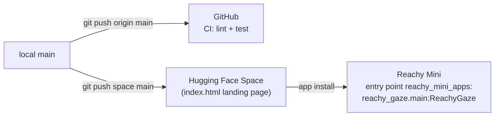

The robot installs the app from the Hugging Face Space, so a change only
reaches it once it is pushed to the `space` remote. The detection server is
run separately on the GPU host with `uv sync --extra server` and
`uv run reachy-gaze-server`.
