# Architecture

Reachy Gaze is a Reachy Mini app that points the robot's head at people and
pets. It is split across two machines: the **robot** runs the app (control
loop, vision thread and control panel), and a **GPU machine** runs object
detection. The robot sends downscaled JPEGs over the network and gets
bounding boxes back.

This document covers how the pieces fit together. See the
[README](README.md) for setup and the behaviour as a user sees it.

## Repository Layout

```
reachy_gaze/
├── main.py          # the app: ReachyGaze, shared State, control loop, vision thread, panel API
├── cycle.py         # look-around state machine (Phase, Cycle), Stillness, Ignored
├── tracking.py      # TargetSelector, CenterFilter, PoseSmoother, coordinate helpers
├── detector.py      # Detector protocol, Triton / built-in / VLM clients, BACKENDS registry
├── server/
│   ├── app.py       # built-in FastAPI + YOLO detection server (reachy-gaze-server)
│   └── traffic.py   # per-client request accounting for the server's logs
└── static/          # control panel served by the app: index.html, main.js, style.css
tests/               # pytest suites per module, plus test_panel.mjs for main.js
index.html, style.css  # Hugging Face Space landing page (not the control panel)
.github/workflows/   # lint.yml (black, isort) and test.yml (pytest + node panel test)
```

## System Context

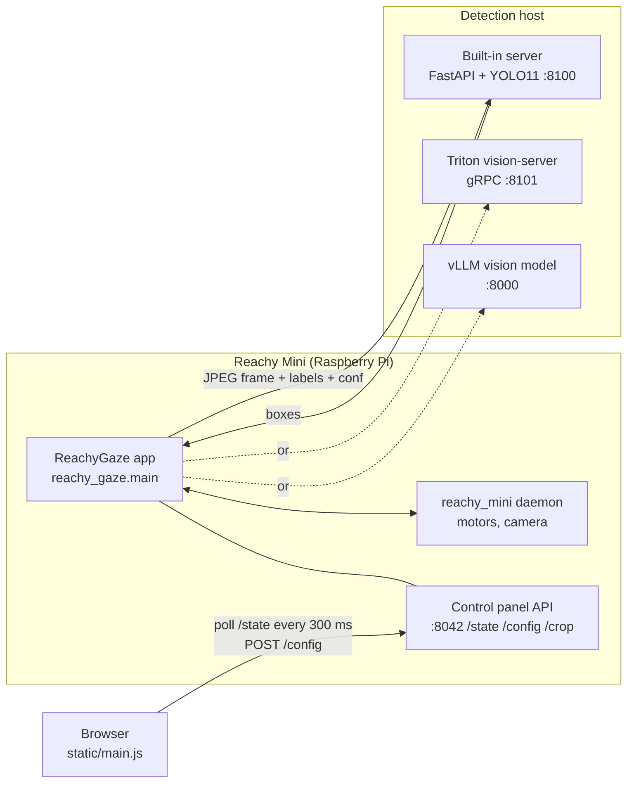

Only one backend is active at a time. It is chosen in the panel, or with
`REACHY_GAZE_BACKEND` and `REACHY_GAZE_SERVER_URL`.

## Module Dependencies

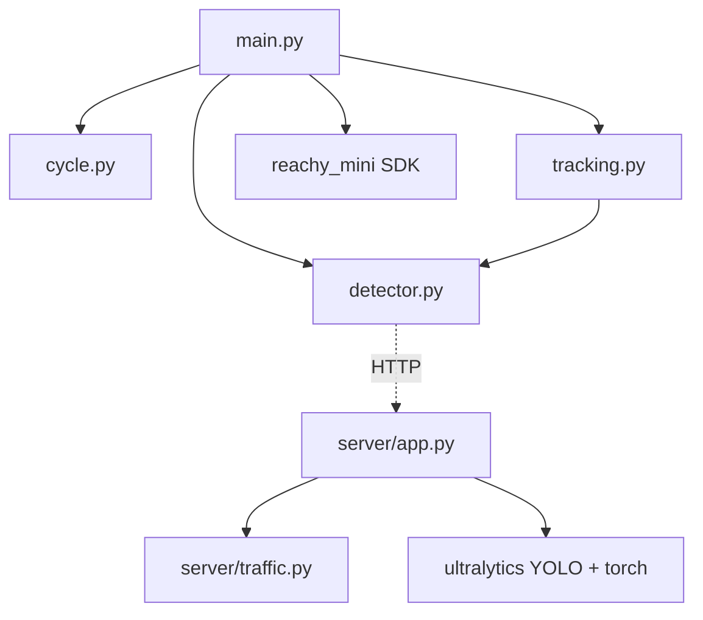

`cycle.py`, `tracking.py` and `detector.py` don't depend on the robot SDK,
so they can be tested in isolation. `server/` is installed only with the
`server` extra and never runs on the robot.

## Classes

### App and Shared State

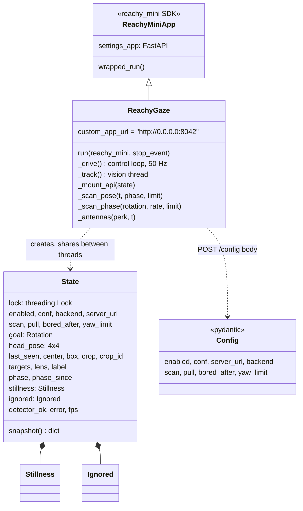

`State` is the only thing shared between the two threads and the HTTP
handlers. Every read and write happens under `State.lock`, and `snapshot()`
reads everything the panel shows in one consistent pass.

### Look-Around Cycle

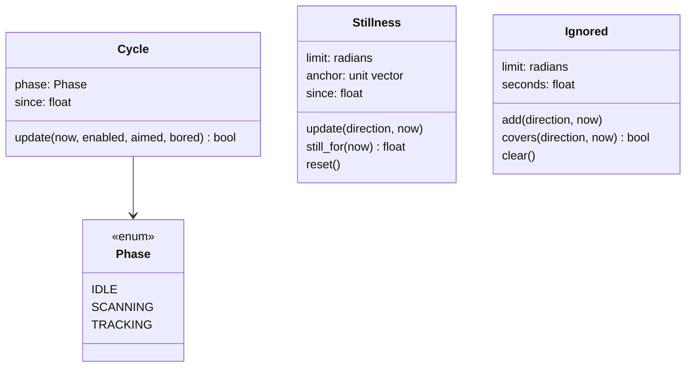

`Cycle` takes the current time as an argument rather than reading the clock,
so tests can step it through a whole cycle without waiting.

### Tracking and Smoothing

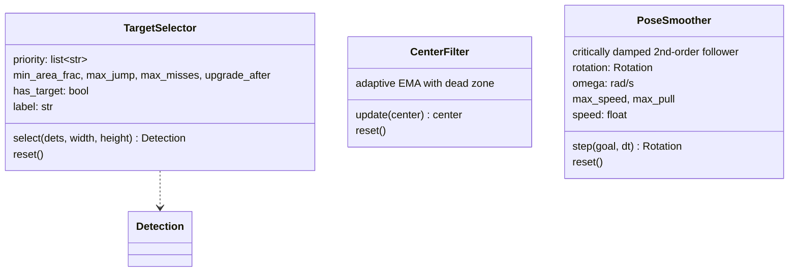

### Detectors

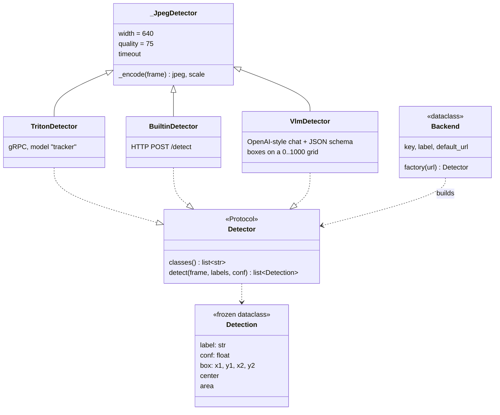

`BACKENDS` maps `"triton"`, `"builtin"` and `"vlm"` to a `Backend`, and
`make_detector(backend, url)` builds the client. To add a backend, write a
`Detector` and add one line to `BACKENDS`; the panel picks it up from
`/state`. A client raises `DetectorUnavailable` when its server is down or
answers with garbage. That is the only exception the vision thread catches.

## Runtime: Threads and Data Flow

`ReachyGaze.run` mounts the panel API, checks that the camera is calibrated,
turns on automatic body yaw, then starts two loops.

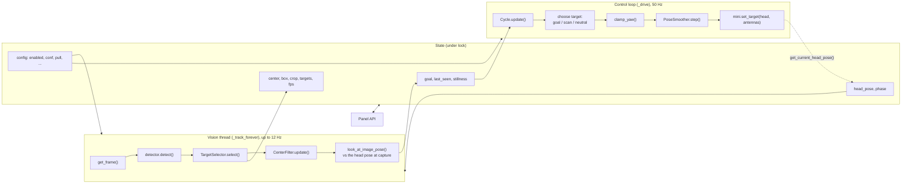

The two rates are deliberate. Detection is slow and comes in jumps, so the
vision thread only moves the **goal**. The control loop then moves the head
toward that goal smoothly at 50 Hz. `PoseSmoother` carries angular velocity
as state, so the commanded velocity stays continuous even when the goal jumps.

### One Detection, End to End

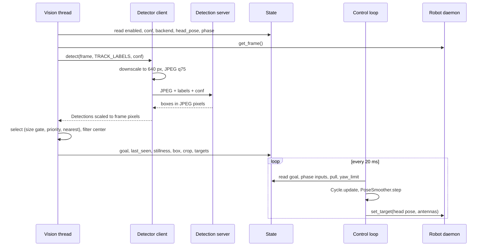

If the detector raises `DetectorUnavailable`, the vision thread marks
`detector_ok = False`, clears the targets and waits `RETRY_AFTER` (2 s)
before trying again. Changing the backend or URL in the panel rebuilds the
client and resets the selector and filter. It also calls `classes()` to warn
if the model can't detect one of `TRACK_LABELS`.

## The Look-Around Cycle

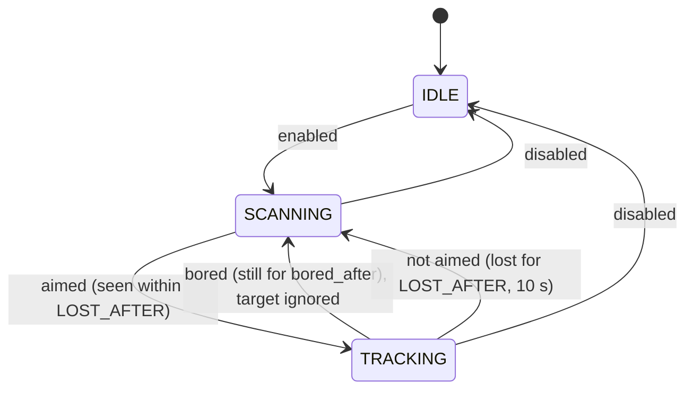

On entering a phase, `_enter_phase` publishes it to `State`. Going idle, or
leaving `TRACKING` out of boredom, clears the goal and the box. A lost target
keeps its held aim instead, which no longer matters once the scan takes over.

What the control loop aims at in each phase:

| Phase      | Head target                                                           |
| ---------- | --------------------------------------------------------------------- |
| `idle`     | Neutral orientation at `REST_POSITION`                                |
| `scanning` | A yaw sine sweep starting from the current yaw and direction          |
| `tracking` | `State.goal`, the world-frame direction of the target                 |

Every target is passed through `clamp_yaw` with the panel's Travel limit.
The antennas wag while searching and perk up while tracking, eased with
`BLEND_TAU`.

### Boredom

`Stillness` keeps the target's world-frame direction as an anchor. If the
target moves more than `STILL_DEGREES` (8°) from it, the anchor and clock
reset. A target that keeps moving is followed indefinitely. One that stays
put for `bored_after` seconds sends the head back to scanning.

A bored target usually hasn't gone anywhere, so on boredom its settled
direction goes into `Ignored`. For `IGNORE_SECONDS` (60 s), the vision thread
drops any detection within `IGNORE_DEGREES` (15°) of it, before selection,
which means the scan sweeps past it. The check is repeated when the goal is
published, in case boredom struck while a detection was in flight. Going idle
clears the list.

## Target Selection

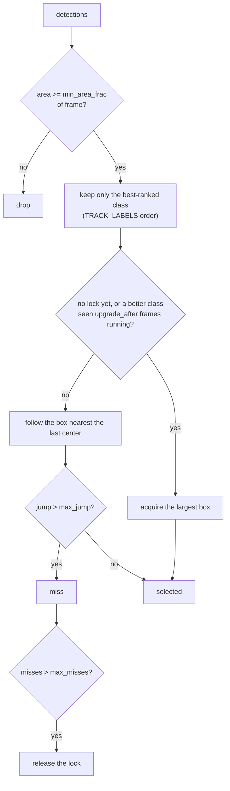

`TRACK_LABELS = ["cat", "dog", "bird", "person"]` sets both what to look for
and the preference order. A cat will take the head off a person, but only
after being seen for several frames in a row. That keeps a detection
flickering at the confidence threshold from bouncing the head between the
two. The size gate (`MIN_AREA_FRAC`, 1% of the frame) runs first, so a tiny
false positive of a preferred class can't hide a real one.

## Coordinate Conventions

| Quantity                  | Frame / units                                                       |
| ------------------------- | ------------------------------------------------------------------- |
| `Detection.box`           | Full-resolution camera pixels, `(x1, y1, x2, y2)`                   |
| Server reply              | Pixels of the JPEG sent, rescaled by `_encode`'s factor             |
| VLM reply                 | A 0–1000 grid, mapped to frame pixels                               |
| `norm_center`             | Box center in `[-1, 1]` on both axes                                |
| `State.box`               | Fractions of the frame, for the panel to draw                       |
| `State.goal`, head pose   | World frame: +X forward, +Y left, +Z up; body yaw included          |
| Head position             | Metres; raised by `HEAD_LIFT` so the head clears the body           |

The goal is computed with `look_at_image_pose` against the head pose
captured with the frame, not the current one. A detection that arrives late
still points where the target was.

## Control Panel

The app mounts three endpoints on the SDK's `settings_app` at `:8042`:

| Endpoint       | Purpose                                                                |
| -------------- | ---------------------------------------------------------------------- |
| `GET /state`   | `State.snapshot()`: settings, lock, phase, aim, boxes, lens, fps       |
| `GET /crop`    | JPEG of the current target box, or 404                                 |
| `POST /config` | Partial `Config` update; returns a fresh snapshot                      |

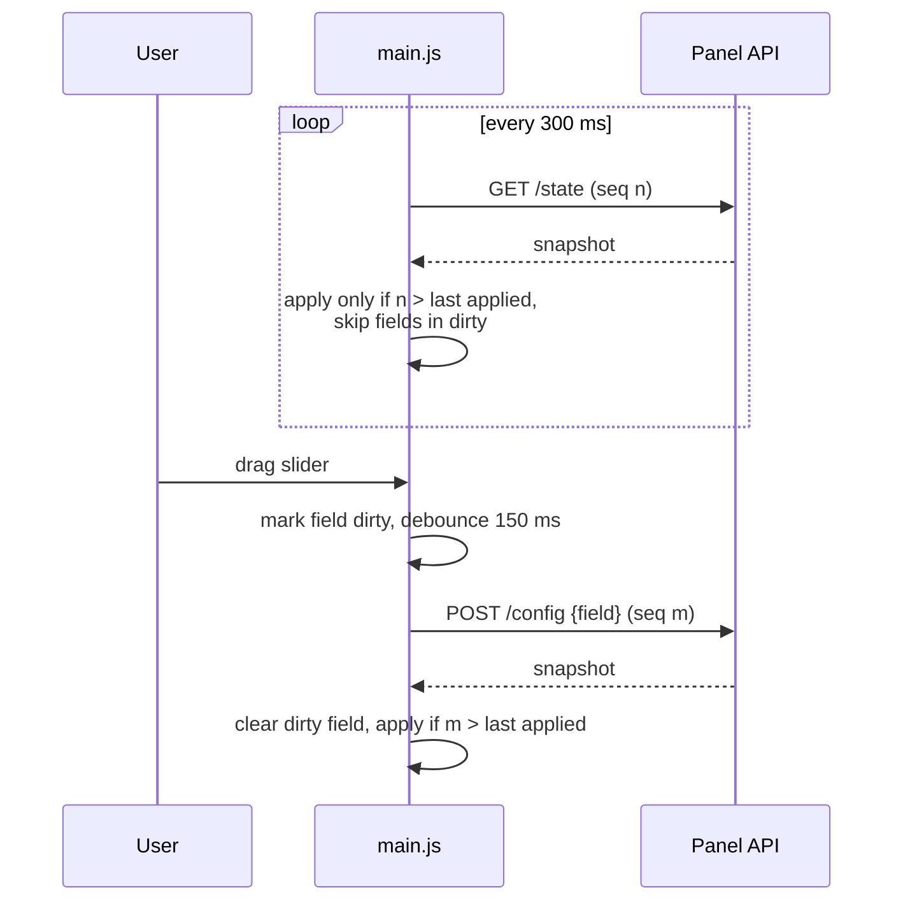

Responses can arrive out of order, so `main.js` numbers every request and
never lets an older response overwrite a newer one. Fields the user has
edited but the app hasn't confirmed yet are tracked in `dirty`, so a poll
can't overwrite them. `tests/test_panel.mjs` reproduces these interleavings
against a stubbed DOM.

## Built-in Detection Server

`reachy-gaze-server` (`reachy_gaze/server/app.py`) is a FastAPI app around an
Ultralytics YOLO model (`yolo11x.pt` by default). It picks CUDA, then MPS,
then CPU.

| Endpoint       | Purpose                                                       |
| -------------- | ------------------------------------------------------------- |
| `POST /detect` | JPEG body, `labels` and `conf` query params; returns boxes    |
| `GET /classes` | The model's vocabulary                                        |
| `GET /health`  | Whether the model is loaded and the device it runs on         |

Requested labels are passed to YOLO as `classes=`, so filtering happens in
the model. With no known labels it detects everything, which is why the app
checks the vocabulary on connect. Per-request access logs are off by default.
Instead, `Traffic` counts requests per client and logs first contact, a
summary every 10 s, and when a client goes quiet.

## Tuning Constants

All of these are at the top of `reachy_gaze/main.py`. The ones marked
*panel* are only defaults, overridable live through `/config`.

| Constant         | Default | Effect                                                   |
| ---------------- | ------- | -------------------------------------------------------- |
| `TRACK_LABELS`   | 4 cls   | Classes to look for, in preference order                 |
| `MIN_AREA_FRAC`  | 0.01    | Smallest box, as a share of the frame, that is used      |
| `CONTROL_HZ`     | 50      | Control loop rate                                        |
| `DETECT_HZ`      | 12      | Ceiling on detection requests                            |
| `SMOOTH_TAU`     | 0.09 s  | Follower time constant                                   |
| `MAX_HEAD_SPEED` | 3.5     | rad/s cap on head rotation                               |
| `MAX_HEAD_PULL`  | 5.0     | rad/s² cap on the follower's pull (*panel*: Response)    |
| `SCAN_DEGREES`   | 90°     | Scan half-width (*panel*: Travel)                        |
| `SCAN_HZ`        | 0.04    | Scan rate                                                |
| `LOST_AFTER`     | 10 s    | How long the aim is held after the last sighting         |
| `BORED_AFTER`    | 20 s    | Stillness before moving on (*panel*: Boredom)            |
| `STILL_DEGREES`  | 8°      | Movement that resets the boredom clock                   |
| `IGNORE_DEGREES` | 15°     | How close to a bored target a detection is ignored       |
| `IGNORE_SECONDS` | 60 s    | How long a bored target is ignored                       |
| `HEAD_LIFT`      | 0.02 m  | Holds the head up off the body                           |

The detection confidence threshold (`conf`, 0.75) is also set in the panel.

## Testing and CI

| Suite                    | Covers                                                       |
| ------------------------ | ------------------------------------------------------------ |
| `tests/test_cycle.py`    | Phase transitions, stillness, ignored directions             |
| `tests/test_tracking.py` | Selector, filters, smoother, scan posture, vocabulary check  |
| `tests/test_detector.py` | Each backend's request and response handling                 |
| `tests/test_control.py`  | `ReachyGaze` against a fake robot, `Config`, phases          |
| `tests/test_traffic.py`  | Server traffic accounting                                    |
| `tests/test_panel.mjs`   | Out-of-order responses and dirty-field handling in `main.js` |

`test.yml` installs the GStreamer and girepository system packages the robot
SDK imports, syncs with Python 3.13, and runs pytest followed by the node
panel test. `lint.yml` runs black and isort. Run them locally with:

    uv sync --extra dev
    uv run pytest
    node tests/test_panel.mjs

## Deployment

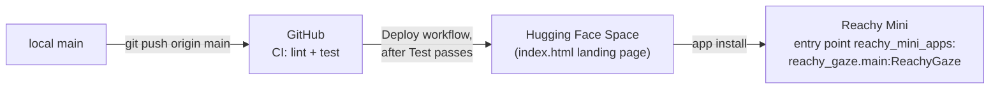

The robot installs the app from the Hugging Face Space. `deploy.yml` runs
after each successful Test run on a push to `main` and pushes that commit to
the Space named by the `HF_SPACE` variable, authenticating with the
`HF_TOKEN` secret. The detection server is
run separately on the GPU host with `uv sync --extra server` and
`uv run reachy-gaze-server`.

## Design Critique

### What Works Well

- **Two rates, one goal.** Splitting the slow, jumpy detection from a 50 Hz
  critically damped follower makes the head move smoothly with a detector
  that runs at a few frames per second. This is the core idea of the design
  and it is sound.
- **Pure, testable cores.** `Cycle`, `Stillness`, `TargetSelector`,
  `CenterFilter` and `PoseSmoother` take their inputs explicitly (`Cycle`
  even takes the time), have no SDK imports, and are covered directly by
  tests.
- **Pluggable detectors.** The `Detector` protocol plus the `BACKENDS`
  registry keeps adding a backend to one class and one line, and the panel
  discovers it without changes.
- **World-frame reasoning where it matters.** The goal and boredom are both
  computed in the world frame against the pose the frame was captured at, so
  the head's own motion doesn't read as the target moving.

### Weaknesses and Suggestions

Ordered roughly by how much each one affects behaviour on the robot.

#### 1. One Frame Is Enough to Lock On

When nothing is locked, `TargetSelector` takes the first detection that
passes the size gate. Setting `State.goal` immediately turns `SCANNING` into
`TRACKING`, and the aim is then held for `LOST_AFTER` (10 s). A single-frame
false positive therefore costs ten seconds of staring at nothing. Size gating
(`MIN_AREA_FRAC`) treats a symptom of this; a tiny box is just the most
common way a one-frame ghost shows up.

*Suggestion:* require a candidate to be seen in N of the last M frames
(e.g. 3 of 4) near the same spot before acquiring, reusing the
`upgrade_after` idea that already protects upgrades. Also consider a short
`LOST_AFTER` for a target seen only briefly, and the full 10 s only once it
has been tracked for a while.

#### 2. The Pose Used for Aiming Is Not the Capture Pose

The vision thread reads `state.head_pose` at the top of its loop, then calls
`get_frame()`, then waits for the detector. The comment says the goal is
computed "against the pose the frame was captured at", but the pose is read
before the frame and ignores camera latency. While the head is moving fast,
as in a scan or a chase, this misplaces the goal by however far the head
turned in that gap, and the follower then corrects it on the next frame,
which shows up as small overshoots.

*Suggestion:* have the control loop keep a short ring buffer of
timestamped head poses, and interpolate it at the frame's capture time
(minus a measured camera latency) when computing the goal.

#### 3. Association Happens in Image Space

`TargetSelector` follows the box nearest the last normalized image center
and rejects jumps over `max_jump`. When the head turns, every object moves
in the image, so a fast head motion can push the real target past
`max_jump` (a miss) or bring a different object into the old spot (a swap).

*Suggestion:* associate in the world frame. Convert each detection to a
world direction with the capture pose, as is already done for the goal and
for `Stillness`, and gate on angle. That makes the selector independent of
what the head is doing, and `max_jump` becomes a physical angle.

#### 4. Detection Is Strictly Serial

Each vision iteration captures, encodes, sends, waits and only then captures
again, so the frame rate is bounded by one network round trip plus
inference. On wifi that round trip, not the GPU, sets the rate, and every
result is at least one round trip old.

*Suggestion:* keep one request in flight while capturing the next frame
(a small pipeline with a depth of two), and drop results older than the
newest one received. Pairs naturally with timestamped poses from point 2.

#### 5. `main.py` Does Too Much

`main.py` holds the tuning constants, `Config`, `State`, the control loop,
the vision loop, the panel API, scan math and antenna animation in about 650
lines. The control and vision loops themselves aren't unit testable without
a fake robot, and they read `time.monotonic()` directly, unlike `Cycle`.

*Suggestion:* split into `control.py` (the `_drive` loop and scan helpers),
`vision.py` (the `_track` loop), `api.py` (endpoints) and `settings.py`
(constants and `Config`), with `main.py` only wiring them. Pass a clock in
so whole-loop tests can run without real time.

#### 6. `State` Is a Shared Bag of Fields

`State` mixes three kinds of data: user settings, what the vision thread
saw, and status for the panel. Any of the three writers (control loop,
vision thread, HTTP handlers) can touch any field. Related fields such as
`goal`, `center`, `box`, `crop` and `label` are set and cleared together in
three different places (`_track_forever`, `_enter_phase`, `set_config`),
and a missed one leaves the panel inconsistent.

*Suggestion:* replace the related fields with immutable objects published
whole: a `Settings` dataclass replaced on each `/config`, and a `Sighting`
(goal, box, crop, label, time) replaced by the vision thread or set to
`None`. Clearing then becomes one assignment, and readers can take a
reference without holding the lock.

#### 7. A Dead Vision Thread Degrades Silently

If the vision thread raises anything other than `DetectorUnavailable`, it
records the error and exits, while the control loop carries on scanning
forever. The panel shows the error, but the robot looks like it is working.

*Suggestion:* either restart the thread with a backoff, or have the control
loop notice it has died and stop the app, so the failure is obvious.

#### 8. The Size Gate Is Applied Twice

`MIN_AREA_FRAC` is enforced inside `TargetSelector.select` and again in
`_track_forever` when filling `state.targets`. The two can drift apart.

*Suggestion:* filter detections once, right after `detect()`, and give the
selector already-filtered input. A per-class minimum (a bird is smaller than
a person) would fit naturally there.

#### 9. Settings Live in Code and Don't Persist

Most tuning values are module constants, so changing one means a commit and
a push to the Space. The few the panel can change are lost on restart.
`STALE_AFTER` in `main.py` is unused, and `main.js` hard-codes its own,
different value while claiming to mirror it.

*Suggestion:* load defaults from a small settings file, save panel changes
back to it, and send display constants such as `STALE_AFTER` in `/state`
rather than duplicating them in JavaScript.

#### 10. The Panel Can Redirect the Camera

The panel listens on `0.0.0.0:8042` with no authentication, and `/config`
accepts any `server_url`. Anyone on the network can point the robot's camera
stream at a host of their choosing.

*Suggestion:* bind to localhost by default or require a token for writes,
and at minimum log every change to the backend or server URL.

#### 11. The Built-in Server Blocks Its Event Loop

`/detect` is declared `async` but calls `_model.predict` synchronously, so
inference blocks the event loop. While a frame is being processed, no other
request (including `/health` and other robots) is even accepted.

*Suggestion:* declare the endpoint with plain `def`, so FastAPI runs it in a
worker thread, or wrap the prediction in `run_in_threadpool`. If several
robots share one server, batch their frames.

#### 12. Backends Don't Behave the Same

The three detectors interpret the same `detect(frame, labels, conf)` call
differently. The built-in server returns every class when it knows none of
the labels, and the VLM rarely scores its boxes, so `conf` is mostly
ignored and every box gets 1.0. The app compensates with a vocabulary check
at connect time.

*Suggestion:* make the contract strict in the client layer: always filter
returned detections to the requested labels and confidence, and let each
backend declare its capabilities (scored or not, open vocabulary or not) so
the panel can show them.

#### 13. Fragile Toolchain

`requires-python` is `>=3.10`, but the SDK's `pygobject` 3.46 does not import
on 3.14, which is what broke CI.

*Suggestion:* cap `requires-python` below 3.14 until the SDK moves to a newer
`pygobject`.

### Suggested Order of Work

| Step | Change                                       | Why first                                     |
| ---- | -------------------------------------------- | --------------------------------------------- |
| 1    | Multi-frame confirmation before acquiring    | Directly addresses the false-positive locks   |
| 2    | Single size filter, per-class minimums       | Small, and pairs with step 1                  |
| 3    | Timestamped pose buffer                      | Fixes aim error while moving                  |
| 4    | World-frame association                      | Builds on step 3; fewer misses and swaps      |
| 5    | Split `main.py`, immutable `Sighting`        | Makes steps 3 and 4 easier to test            |
| 6    | Pipelined detection                          | Higher frame rate once the above is solid     |
| 7    | Panel auth, persisted settings               | Operational hygiene                           |
